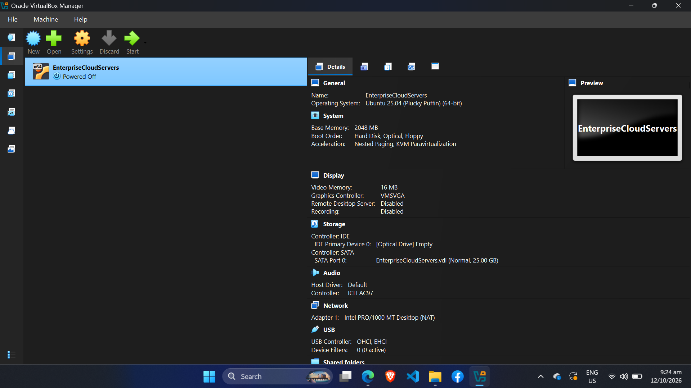
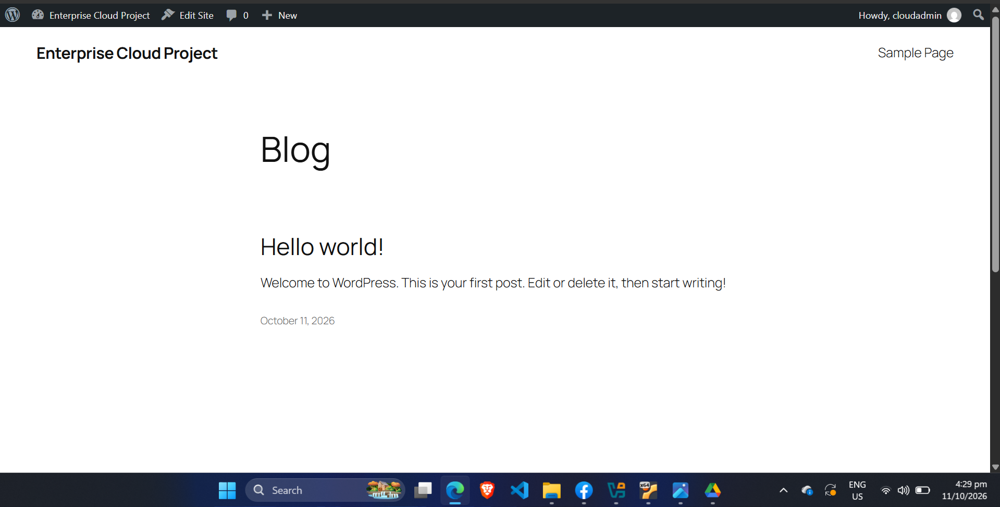

# Requirement 1: Base Infrastructure & Architecture Design

## 1. Network Topology and Architecture Diagram

**Explanation:**  
The network topology and architecture diagram shows how the different components of the cloud infrastructure are connected. The **host machine** provides the physical hardware and operating system where the **hypervisor**, such as VirtualBox, runs the **Linux Virtual Machine (VM)**. Inside the Linux VM, a **firewall** controls and filters network traffic to improve security. The VM also runs **Docker**, which manages separate containers for the **Web Application, API, and Database**. The Docker containers communicate through a **Docker bridge network**, while the firewall helps control traffic entering and leaving the system. Overall, the diagram shows the flow of network traffic and how virtualization, security, and containerization work together in the cloud environment.

---

## 2. Provision a Virtual Machine and Install Ubuntu Server

**Explanation:**  
The Virtual Machine was provisioned using a hypervisor, where **Ubuntu Server** was installed as the operating system. The VM provides an isolated environment that uses allocated **CPU, RAM, storage, and network resources** from the host machine. This Ubuntu Server environment serves as the main platform for configuring and deploying the cloud infrastructure and Docker services.

---

## 3. Configure VM Networking for Browser Access

**Explanation:**  
The VM networking was configured to allow the **host laptop to access the server through a web browser**. The successful display of the **Enterprise Cloud Project WordPress website** confirms that the network connection between the host machine and the VM is working properly and that the web server is accessible from the host.
