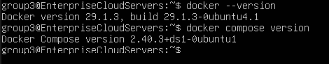
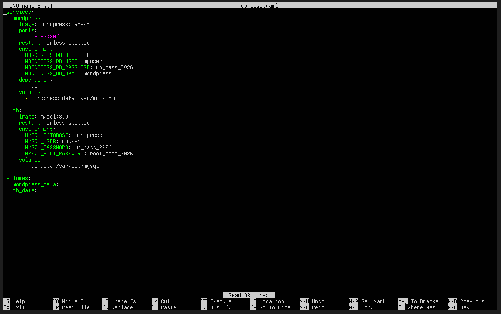
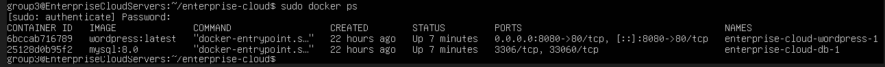
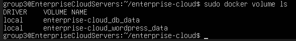

# Requirement 2: Infrastructure Integration (Deployment)

## 1. Install Docker and Docker Compose on your new Ubuntu Server



### Explanation

Docker and Docker Compose were installed on the Ubuntu Server to provide the environment needed to deploy and manage the cloud services using containers. After installation, the versions were checked to confirm that both Docker and Docker Compose were installed and working correctly.

**Docker version verification:**
```bash
docker --version
```

**Docker Compose version verification:**
```bash
docker compose version
```

These commands confirm that the Docker engine and Docker Compose are properly installed and ready to be used for deploying the project's containerized services.

---

## 2. Write a complete docker-compose.yml file



### Explanation

A complete `docker-compose.yml` file was created to define and configure the project's Docker services. The file contains the settings needed to run and connect the different containers, making it easier to deploy and manage the cloud application.

**First, go to the project directory:**
```bash
cd ~/enterprise-cloud
```

**Next, create or edit the Compose file:**
```bash
nano compose.yaml
```

The `compose.yaml` file is then used to define the required Docker containers, networks, volumes, and other configurations for the Enterprise Cloud Project.

---

## 3. The stack must include at least two linked containers



### Explanation

The Docker stack uses **two linked containers: WordPress and MySQL**. WordPress serves as the web application, while MySQL acts as the database that stores the website's data. The two containers are connected through the Docker network, allowing WordPress to communicate with the MySQL database.

After starting the Docker stack, the following command was used to verify that the containers are running:

```bash
sudo docker ps
```

The `sudo docker ps` command displays the currently running Docker containers, allowing us to confirm that both the **WordPress** and **MySQL** containers are active and running properly.

---

## 4. The database must utilize Persistent Volumes so that data survives a VM reboot



### Explanation

The MySQL database was configured to use a **Persistent Volume** so that the stored database data will remain available even if the Ubuntu VM is restarted or rebooted. This helps prevent data loss and ensures that the WordPress website can continue using the existing database after the VM is turned back on.

**To verify the Docker volumes, use:**

```bash
sudo docker volume ls
```

The `sudo docker volume ls` command displays the Docker volumes available on the system. This confirms that a persistent volume is being used to store the database data separately from the MySQL container.

### Persistence Test

To verify that the persistent volume works correctly, a test post was created in WordPress and the VM was rebooted. The following steps were performed:

#### Step 1 — Create a Test Post in WordPress

The WordPress website was opened in the Windows browser:

**http://127.0.0.1:8080**

The WordPress admin panel was accessed through:

**http://127.0.0.1:8080/wp-admin**

A new WordPress post was created with the title:

**Persistence Test 101**

#### Step 2 — Check That the Containers Are Running

In the Ubuntu terminal, the following command was used:

```bash
sudo docker ps
```

The WordPress and MySQL containers should be listed with a status of **Up**, confirming that both containers are running.

#### Step 3 — Restart the Ubuntu VM

The Ubuntu VM was restarted using:

```bash
sudo reboot
```

The terminal disconnected while the VM was restarting. After the VM finished booting, the user logged in again.

The Docker volumes were not deleted. Only the VM was rebooted to test whether the stored data would remain available.

#### Step 4 — Check the Containers After the Reboot

After logging back into Ubuntu, the following command was used:

```bash
sudo docker ps
```

The container status was checked to determine whether the WordPress and MySQL containers were running again after the VM reboot.

#### Step 5 — Check if the Test Post Still Exists

The WordPress website was opened again:

**http://127.0.0.1:8080**

The **Persistence Test 101** post was checked to verify that it was still available. The WordPress admin panel can also be accessed through:

**http://127.0.0.1:8080/wp-admin**

and the post can be checked from the **Posts** list.

If the **Persistence Test 101** post is still available after the VM reboot, the data persistence test is successful. This confirms that the MySQL data stored in the persistent volume was preserved after restarting the Ubuntu VM.

If the website is not accessible, the container status should be checked first. If the website becomes accessible but the test post is missing, the persistence test should not be considered successful.
