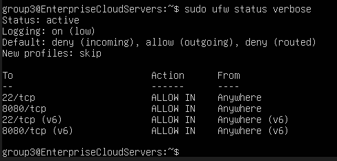
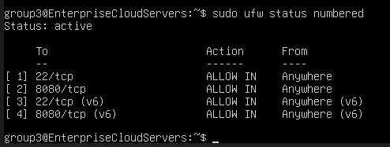

# Requirement 3: Security Configurations (Hardening)

## 1. You must configure and enable the Uncomplicated Firewall (UFW)



### Explanation

The **Uncomplicated Firewall (UFW)** was configured and enabled on the Ubuntu Server to provide basic network security. A **Default Deny** policy was enforced to block incoming connections unless they are explicitly allowed. This helps protect the server from unauthorized network access while still allowing required services to function.

**To check the UFW firewall status and current policies, use:**

```bash
sudo ufw status verbose
```

The `sudo ufw status verbose` command displays whether UFW is active and shows the current default policies and allowed rules. This verifies that the firewall is enabled and that the default incoming traffic policy is set to **deny**.

---

## 2. Explicitly allow only the ports absolutely necessary for your chosen application and remote administration (SSH)



### Explanation

Only the ports required by the application and for **remote administration through SSH** were explicitly allowed through the firewall. This follows the principle of minimizing unnecessary network access and helps reduce potential security risks.

**To verify the allowed UFW rules, use:**

```bash
sudo ufw status numbered
```

The `sudo ufw status numbered` command displays the active firewall rules with their corresponding rule numbers. This allows the configured ports to be checked and confirms that only the necessary services and SSH access are allowed.
